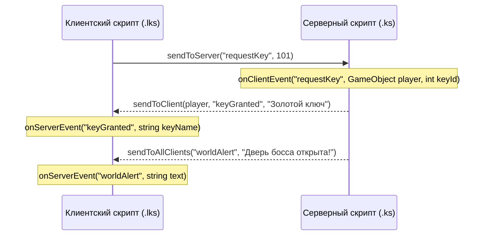

# Level Script — полная документация

Level Script — C-подобный интерпретируемый скриптовый язык игры Kaplao, предназначенный для процедурной анимации, игровой логики уровней, управления окружением и сетевого взаимодействия.

Скрипты хранятся в папке мира `Scripts/`, пишутся во встроенном редакторе режима **Code** и разделяются на два типа исполнения:
- **Серверные скрипты (`.ks`)**: точка входа `main.ks`. Исполняются на сервере (listen host) и управляют синхронизированными группами тайлов, физикой, чекпоинтами и глобальным состоянием мира.
- **Локальные скрипты (`.lks`)**: клиентские скрипты (например `client.lks`). Исполняются локально у каждого игрока и управляют локальной камерой, персональным интерфейсом, звуками и локальной реакцией на действия игрока.

Запуск логики осуществляется кнопкой **Run** (горячая клавиша `F5`), остановка — кнопкой **Stop** (`Shift+F5`). При остановке весь мир автоматически возвращается в исходное состояние.

---

## Содержание

1. [Архитектура и рантайм](#архитектура-и-рантайм)
2. [Матрица возможностей: Сервер (.ks) vs Клиент (.lks)](#матрица-возможностей-сервер-ks-vs-клиент-lks)
3. [Быстрый старт](#быстрый-старт)
4. [Структура программы](#структура-программы)
5. [Типы данных и значения](#типы-данных-и-значения)
6. [Переменные, операторы и модули](#переменные-операторы-и-модули)
7. [Выражения и математические функции](#выражения-и-математические-функции)
8. [Управление потоком выполнения](#управление-потоком-выполнения)
9. [Пользовательские функции](#пользовательские-функции)
10. [Параллельность (`spawn`)](#параллельность-spawn)
11. [Группы, объекты и игроки](#группы-объекты-и-игроки)
12. [Триггеры уровня](#триггеры-уровня)
13. [Локальные скрипты (.lks) и сетевые события (Network)](#локальные-скрипты-lks-и-сетевые-события-network)
14. [Встроенные команды анимации и движения](#встроенные-команды-анимации-и-движения)
15. [Хитбоксы и физика коллизий](#хитбоксы-и-физика-коллизий)
16. [Спрайты, цвет и визуальные эффекты](#спрайты-цвет-и-визуальные-эффекты)
17. [Управление камерой (`Camera`)](#управление-камерой-camera)
18. [Управление задним планом (`Background`)](#управление-задним-планом-background)
19. [Мир, физика и сетка тайлов (`World`)](#мир-физика-и-сетка-тайлов-world)
20. [Пользовательский интерфейс (`UI`)](#пользовательский-интерфейс-ui)
21. [Консоль Output и вывод (`print()`)](#консоль-output-и-вывод-print)
22. [Звуковое сопровождение](#звуковое-сопровождение)
23. [Спавн и контрольные точки (чекпоинты)](#спавн-и-контрольные-точки-чекпоинты)
24. [Создание динамических объектов и компоненты Unity](#создание-динамических-объектов-и-компоненты-unity)
25. [Функции плавности (Easing)](#функции-плавности-easing)
26. [Возможности встроенной IDE (Code Mode)](#возможности-встроенной-ide-code-mode)
27. [Настройка IDE в Unity Editor (меню Kaplao)](#настройка-ide-в-unity-editor-меню-kaplao)
28. [Практические примеры](#практические-примеры)
29. [Диагностика и обработка ошибок](#диагностика-и-обработка-ошибок)

---

## Архитектура и рантайм

| Компонент | Роль в системе |
|---|---|
| `LevelScriptParser` | Лексический и синтаксический анализ исходного кода в AST-дерево узлов. |
| `LevelScriptSemanticAnalyzer` | Статическая валидация, проверка типов, проверка областей видимости и контекстов (сервер vs клиент). |
| `LevelScriptModuleLinker` | Разрешение зависимостей `using`, экспорт `public` и инкапсуляция `private` символов. |
| `LevelScriptRuntime` | Серверный рантайм: корутины анимаций, триггеры, управление тайлами и сетевая синхронизация. |
| `LevelScriptLocalRuntime` | Клиентский рантайм: корутины клиентских скриптов `.lks`, локальные эффекты камеры, локальный UI и обработка входящих сетевых событий. |
| `LevelScriptIdeService` | Языковой сервис редактора: контекстный автокомплит, подсветка параметров сигнатур, подсветка синтаксиса. |
| `LevelScriptCodeEditorEnhancer` | Поведение поля ввода IDE: клавиши со стрелками, Tab-сниппеты, автозакрытие скобок. |
| `KaplaoCodeOutputPanel` | Многострочная консоль вывода: цветовая дифференциация логов, таймштампы, копирование и фильтрация. |
| `ParallaxBackground` | Система многослойного параллакса уровня (цвета слоев, скорости скролла, прозрачность). |
| `LevelGroupAnimator` | Управление геометрическими трансформациями групп тайлов относительно pivot. |

### Жизненный цикл и гарантированное восстановление (Stop)
При нажатии кнопки **Stop** (или остановке сессии) рантайм гарантирует полный откат всех изменений:
- **Тайлы**: возвращаются исходные позиции, повороты, масштабы, настройки хитбоксов, спрайты, цвета и текстуры.
- **Физика и время**: восстанавливается исходная гравитация `Physics2D.gravity` и масштаб времени `Time.timeScale = 1.0`.
- **Камера**: отвязывается от объектов слежения, гасятся эффекты тряски, зума и экранных fade-заливок.
- **Интерфейс**: удаляются динамические оверлеи баннеров и таймеров.
- **Задний план**: восстанавливается исходная конфигурация и палитра слоев параллакса.
- **Созданные и удаленные объекты**: все динамически созданные через `instance()` объекты уничтожаются, а удаленные через `destroy()` восстанавливаются.
- **Корутины**: все параллельные задачи `spawn` как на сервере, так и на клиентах немедленно завершаются.

---

## Матрица возможностей: Сервер (.ks) vs Клиент (.lks)

| Возможность / Команда | Серверные скрипты (`.ks`) | Клиентские скрипты (`.lks`) | Описание |
|---|:---:|:---:|---|
| Переменные, циклы, функции, списки | ✅ | ✅ | Базовый язык идентичен на обеих сторонах |
| `print(...)` | ✅ (префикс `[LevelScript]`) | ✅ (префикс `[LevelScriptLocal]`) | Вывод в консоль Output с таймштампом |
| `localPlayer` | ❌ | ✅ | Ссылка на локального управляемого персонажа |
| `sendToServer(...)` / `Network.sendToServer` | ❌ | ✅ | Отправка сетевого события с клиента на сервер |
| `onServerEvent(...)` / `Network.onServerEvent` | ❌ | ✅ | Обработка события, пришедшего с сервера |
| `sendToClient(...)` / `Network.sendToClient` | ✅ | ❌ | Отправка события конкретному игроку |
| `sendToAllClients(...)` / `Network.sendToAllClients` | ✅ | ❌ | Широковещательная отправка всем клиентам |
| `onClientEvent(...)` / `Network.onClientEvent` | ✅ | ❌ | Обработка запроса от клиента на сервере |
| `onPlayerAdded(...)` | ✅ | ❌ | Реакция сервера на подключение нового игрока |
| `Group(id).OnTriggerEnter/Stay/Exit` | ✅ | ❌ | Физические триггеры уровня рассчитываются на сервере |
| `spawnPoints(from, to)` | ✅ | ❌ | Регистрация чекпоинтов мира |
| `World.setGravity`, `World.setTile` | ✅ | ❌ | Глобальные правила физики и сетка тайлов мира |
| `instance(...)`, `destroy(...)` | ✅ | ❌ | Создание сетевых объектов мира |
| `Camera.*` (`shake`, `zoom`, `panTo`, `fade`) | ✅ (для хоста) | ✅ (локально для клиента) | На клиенте эффекты камеры видит только этот игрок |
| `UI.showBanner`, `UI.showTimer` | ✅ (для хоста) | ✅ (локально для клиента) | На клиенте баннеры отображаются только локально |
| `playSound(...)` | ✅ | ✅ | Проигрывание 2D/3D звука |
| `move(...)` | ✅ (синхронизирует тайлы) | ✅ (локальный сдвиг Transform) | Локальный сдвиг не рассылается другим игрокам |
| `destroySprite`, `setSpriteFlip`, `hitbox` | ✅ | ✅ | Локальная модификация визуализации и коллайдеров |

---

## Быстрый старт

### Серверный скрипт (`Scripts/main.ks`)
Автоматическое открытие ворот при входе игрока в зону триггера и запуск кинематографичной тревоги:

```csharp
bool gateOpened = false;

Group(1).OnTriggerEnter(GameObject player) {
  if (!gateOpened) {
    gateOpened = true;
    print("Игрок " + player.name + " активировал главные ворота!");
    
    UI.showBanner("ВНИМАНИЕ: ВОРОТА ОТКРЫВАЮТСЯ!", 3, "#FFCC00");
    Camera.shake(0.5, 1.0);
    playSound(player.x, player.y, "block/stone/break", 1.5);
    
    move(Group(2), 0, 6, 1.5, "easeInOut");
    wait(1.5);
  }
}
```

### Клиентский локальный скрипт (`Scripts/client.lks`)
Индивидуальный индикатор падения и локальная встряска экрана для конкретного игрока:

```csharp
spawn {
  while (true) {
    if (localPlayer != nil && localPlayer.y < -20.0) {
      Camera.shake(0.4, 0.5);
      UI.showBanner("ОСТОРОЖНО: ОПАСНАЯ ГЛУБИНА!", 1.5, "#FF4444");
      wait(2.0);
    }
    wait(0.2);
  }
}
```

---

## Структура программы

Каждый скрипт состоит из объявлений и операторов верхнего уровня:

| Конструкция | Синтаксис | Область применения |
|---|---|---|
| Подключение модуля | `using path/file.ks` | Импорт `public`-функций и переменных из другого скрипта |
| Объявление функции | `[public\|private] function name(args) { ... }` | Переиспользуемые блоки логики |
| Глобальная переменная | `[public\|private] int score = 0;` | Переменные уровня (по умолчанию `private`) |
| Объектный триггер | `Group(id).OnTriggerEnter(GameObject player) { ... }` | `.ks`: вход персонажа в область группы тайлов |
| Триггер присутствия | `Group(id).OnTriggerStay(GameObject player) { ... }` | `.ks`: нахождение персонажа внутри триггера |
| Триггер выхода | `Group(id).OnTriggerExit(GameObject player) { ... }` | `.ks`: выход персонажа из триггера |
| Подключение игрока | `onPlayerAdded(GameObject player) { ... }` | `.ks`: событие входа нового раннера в сессию |
| Слушатель от клиента | `onClientEvent("event", GameObject player, args...) { ... }` | `.ks`: обработка запроса от клиентского `.lks` |
| Слушатель от сервера | `onServerEvent("event", args...) { ... }` | `.lks`: обработка события от серверного `.ks` |
| Чекпоинты уровня | `spawnPoints(fromGroup, toGroup)` | `.ks`: регистрация групп как автоматических чекпоинтов |
| Параллельный поток | `spawn { ... }` | `.ks` и `.lks`: запуск независимой асинхронной корутины |
| Тело скрипта | Любые операторы и вызовы функций | Выполняются последовательно при старте рантайма |

---

## Типы данных и значения

Level Script поддерживает статически проверяемые и динамически вычисляемые типы:

| Тип | Литералы / Источники | Описание |
|---|---|---|
| `int` | `0`, `42`, `-15` | 32-битное целое число; оператор `/` выполняет целочисленное деление |
| `float` | `0.5`, `3.14`, `-9.8` | Число с плавающей точкой |
| `bool` | `true`, `false` | Логический тип |
| `string` | `"hello"`, `"easeOut"` | Текстовая строка в двойных кавычках |
| `GameObject` | `Group(1)`, `player`, `localPlayer`, `FindNearestPlayer(x, y)`, `Scene.Name`, `nil` | Ссылка на тайлы, группу, персонажа или объект сцены |
| `Component` | `obj.GetComponent<Rigidbody2D>()`, `nil` | Ссылка на компонент Unity |
| `list` / `T[]` | `[1, 2, 3]`, `["a", "b"]`, `[]` | Динамический типизированный список элементов |

### Работа с объектами `GameObject`
Объекты `GameObject` предоставляют доступ к координатам и метаданным:
- `obj.x` — координата X объекта в мировом пространстве.
- `obj.y` — координата Y объекта в мировом пространстве.
- `player.name` / `localPlayer.name` — сетевое имя игрока.
- `localPlayer` — ссылка на локального игрока клиента в `.lks` (если игрок еще не заспавнен, возвращает `nil`).
- `FindNearestPlayer(x, y)` — возвращает ближайшего к точке `(x, y)` игрока (или `nil`, если игроков на сервере нет).

### Динамические списки (`list` / `T[]`)
Списки позволяют хранить коллекции любых типов и динамически управлять ими:

```csharp
list doors = [101, 102, 103];
string[] tags = ["Alpha", "Beta"];

// Добавление элемента в конец списка
doors.add(104);

// Чтение и запись по индексу (0-based)
int first = doors[0];
doors[1] = 205;

// Удаление по индексу
doors.removeAt(2);

// Свойства длины: .count или .length
for (int i = 0; i < doors.count; i++) {
  move(Group(doors[i]), 0, 3, 0.5, "easeInOut");
}

// Полная очистка
doors.clear();
```

---

## Переменные, операторы и модули

### Объявление и инициализация
Каждое объявление переменной требует указания типа и точки с запятой `;` в конце:

```csharp
int counter = 0;
float speed = 4.5;
bool isArmed = false;
string state = "idle";
GameObject target = nil;
list queue = [];
```

### Составные операторы и конкатенация
```csharp
counter += 5;
counter -= 2;
speed *= 1.2;
counter %= 3;

// Автоматическая конкатенация строк со значениями любых типов:
string msg = "Текущий счет: " + counter + " (множитель: " + speed + ")";
msg += " [OK]";
```

### Инкремент и декремент
```csharp
counter++;
counter--;
```

### Модульная система (`using`, `public`, `private`)
Скрипты могут подключать другие файлы проекта для переиспользования логики:

```csharp
// utils/math_lib.ks
public function calcOffset(float baseVal, float mult) {
  return baseVal * mult + 1.5;
}

private int internalSeed = 42;
```

```csharp
// main.ks
using utils/math_lib.ks;

float result = calcOffset(10.0, 2.5);
```

---

## Выражения и математические функции

### Арифметика и сравнение
- Арифметика: `+`, `-`, `*`, `/`, `%` с поддержкой скобок `( )`.
- Сравнение: `<`, `<=`, `>`, `>=`, `==`, `!=`.
- Логика: `&&` (И), `||` (ИЛИ), `!` (НЕ).

### Встроенная математика
Все математические функции поддерживают как `int`, так и `float`:

| Функция | Описание |
|---|---|
| `abs(x)` | Модуль (абсолютная величина) числа |
| `min(a, b)` | Минимальное из двух значений |
| `max(a, b)` | Максимальное из двух значений |
| `sin(rad)` | Синус угла в радианах |
| `cos(rad)` | Косинус угла в радианах |
| `sqrt(x)` | Квадратный корень числа |
| `floor(x)` | Округление вниз до ближайшего целого |
| `ceil(x)` | Округление вверх до ближайшего целого |
| `clamp(val, min, max)` | Ограничение числа диапазоном `[min, max]` |
| `random(min, max)` | Случайное дробное число в диапазоне от `min` до `max` |

---

## Управление потоком выполнения

### Циклы `while` и `for`
```csharp
while (isActive) {
  move(Group(1), 0, 2, 0.4, "easeInOut");
  wait(0.4);
  move(Group(1), 0, -2, 0.4, "easeInOut");
  wait(0.4);
}

for (int i = 0; i < 8; i++) {
  move(Group(10 + i), 0, 1, 0.1, "easeOut");
  wait(0.05);
}
```

В циклах поддерживаются операторы `break;` и `continue;`.

> [!NOTE]
> **Anti-Freeze Watchdog**: если цикл выполняет 5 000 итераций без вызова `wait()`, рантайм автоматически передает управление следующему кадру Unity, предотвращая зависание игры. При превышении 200 000 непрерывных итераций цикл принудительно останавливается с ошибкой.

### Условные переходы `if` / `else if` / `else`
```csharp
if (counter == 0) {
  move(Group(1), 3, 0, 0.5, "easeOut");
} else if (counter == 1) {
  move(Group(1), -3, 0, 0.5, "easeIn");
} else {
  Camera.shake(0.3, 0.5);
}
```

---

## Пользовательские функции

Функции объявляются с помощью ключевого слова `function`, поддерживают типизированные аргументы и оператор `return`:

```csharp
function spawnWave(int startGroup, int count, float delay) {
  for (int i = 0; i < count; i++) {
    move(Group(startGroup + i), 0, 3, 0.2, "easeInOut");
    wait(delay);
  }
  return true;
}
```

---

## Параллельность (`spawn`)

Оператор `spawn { ... }` запускает независимую параллельную корутину:

```csharp
spawn {
  while (true) {
    move(Group(1), 2, 0, 1.0, "easeInOut");
    wait(1.0);
    move(Group(1), -2, 0, 1.0, "easeInOut");
    wait(1.0);
  }
}

spawn {
  while (true) {
    rotate(Group(2), Group(2), 360, 3.0, "linear");
    wait(3.0);
  }
}
```

`spawn` может быть вложенным и имеет полный доступ к переменным охватывающего контекста (включая счетчики циклов `for`).

---

## Группы, объекты и игроки

- `Group(id)` — возвращает массив всех тайлов с групповым ID `id`.
- `{obj1, obj2}` — массив произвольных объектов.
- `Scene.Path.To.Object` — получение объекта Unity по пути в иерархии сцены.
- `FindNearestPlayer(x, y)` — нахождение ближайшего активного игрока.

Событие появления игрока на сервере:
```csharp
onPlayerAdded(GameObject player) {
  print("Новый игрок присоединился: " + player.name);
  UI.showBanner("Добро пожаловать, " + player.name + "!", 3, "#55FF55");
}
```

---

## Триггеры уровня

Объектные триггеры привязываются к группам тайлов:

```csharp
Group(5).OnTriggerEnter(GameObject player) {
  print("Игрок " + player.name + " вошел в триггер 5");
  move(Group(6), 0, -5, 0.5, "easeIn");
}

Group(5).OnTriggerStay(GameObject player) {
  // Вызывается каждый кадр, пока игрок внутри
}

Group(5).OnTriggerExit(GameObject player) {
  print("Игрок вышел из зоны");
}
```

---

## Локальные скрипты (.lks) и сетевые события (Network)

Локальные скрипты исполняются на клиенте каждого игрока независимо. Это позволяет создавать отзывчивый клиентский интерфейс, индивидуальные эффекты камеры и интерактивные механики.



### 1. Клиент $\to$ Сервер (`sendToServer` $\to$ `onClientEvent`)
В клиентском скрипте вызывается `sendToServer(...)` (или `Network.sendToServer(...)`):

```csharp
// client.lks
if (localPlayer != nil && localPlayer.x > 50.0) {
  sendToServer("checkpointReached", 3);
}
```

На сервере обработчик `onClientEvent` **всегда первым параметром получает `GameObject player` (отправителя)**:

```csharp
// main.ks
onClientEvent("checkpointReached", GameObject player, int cpIndex) {
  print("Игрок " + player.name + " достиг чекпоинта " + cpIndex);
  spawnPoint(player, player.x, player.y);
  sendToClient(player, "cpConfirmed", cpIndex);
}
```

### 2. Сервер $\to$ Конкретный клиент (`sendToClient` $\to$ `onServerEvent`)
Сервер указывает целевого игрока первым аргументом:

```csharp
// main.ks
sendToClient(player, "cpConfirmed", 3);
```

Клиент принимает событие через `onServerEvent`:

```csharp
// client.lks
onServerEvent("cpConfirmed", int cpIndex) {
  UI.showBanner("ЧЕКПОИНТ " + cpIndex + " СОХРАНЕН!", 2, "#00FFCC");
  playSound(localPlayer.x, localPlayer.y, "item/shield/block1.ogg", 1.5);
}
```

### 3. Сервер $\to$ Всем клиентам одновременно (`sendToAllClients`)
```csharp
// main.ks
sendToAllClients("bossAwakened", 1.8);
```

```csharp
// client.lks
onServerEvent("bossAwakened", float shakePower) {
  Camera.shake(shakePower, 3.0);
  UI.showBanner("БОСС ПРОСНУЛСЯ!", 3, "#FF2222");
}
```

---

## Встроенные команды анимации и движения

Команды анимации выполняются асинхронно в фоне. Чтобы дождаться завершения движения, используйте `wait(duration)`.

| Команда | Аргументы | Описание |
|---|---|---|
| `move(targets, dx, dy, time, ease)` | `(targets, float, float, float, string)` | Сдвиг объектов на `(dx, dy)` относительно текущей позиции |
| `goto(targets, x, y, time, ease)` | `(targets, float, float, float, string)` | Перемещение объектов в абсолютные мировые координаты `(x, y)` |
| `rotate(targets, pivot, deg, time, ease)` | `(targets, pivot, float, float, string)` | Вращение вокруг pivot на угол `deg` |
| `rotateto(targets, pivot, tx, ty, offset, time, ease)` | `(targets, pivot, float, float, float, float, string)` | Поворот в направлении целевой точки `(tx, ty)` |
| `scaleto(targets, sx, sy, time, ease)` | `(targets, float, float, float, string)` | Плавное масштабирование объектов |
| `transparency(targets, alpha, time, ease)` | `(targets, float, float, string)` | Плавное изменение прозрачности тайлов |
| `visibility(targets, visible)` | `(targets, bool)` | Мгновенное включение / выключение видимости |
| `animate(targetGroup, keyframesGroup)` | `(group, group)` | Запуск анимации по ключевым кадрам |
| `spawnExecutor(targets)` | `(targets)` | Запуск встроенного Executor |
| `wait(seconds)` | `(float)` | Приостановка текущей корутины на указанное количество секунд |

---

## Хитбоксы и физика коллизий

| Команда | Аргументы | Назначение |
|---|---|---|
| `hitbox(targets, enabled)` | `(targets, bool)` | Включение / выключение коллайдера |
| `setHitboxSize(targets, w, h)` | `(targets, float, float)` | Установка ширины и высоты коллайдера |
| `setHitboxOffset(targets, ox, oy)` | `(targets, float, float)` | Смещение центра коллайдера |
| `setHitboxTrigger(targets, isTrigger)` | `(targets, bool)` | Переключение в режим сквозного триггера |
| `setHitboxBounce(targets, bounce)` | `(targets, float)` | Упругость поверхности (коэффициент отскока) |
| `setHitboxFriction(targets, friction)` | `(targets, float)` | Сила трения поверхности |

*Псевдонимы: `hitboxSize`, `hitboxOffset`, `hitboxTrigger`, `hitboxBounce`, `hitboxFriction`.*

---

## Спрайты, цвет и визуальные эффекты

| Команда | Аргументы | Назначение |
|---|---|---|
| `destroySprite(targets)` | `(targets)` | Удаляет `SpriteRenderer`. Коллайдер и физика остаются активными! |
| `setSpriteFlip(targets, flipX, flipY)` | `(targets, bool, bool)` | Отражение спрайта по горизонтали / вертикали |
| `setSortingOrder(targets, order)` | `(targets, int)` | Слой сортировки отрисовки спрайтов |
| `setSpriteAlpha(targets, alpha)` | `(targets, float)` | Мгновенная установка прозрачности (0.0 — 1.0) |
| `setSpriteColor(targets, hex)` | `(targets, string)` | Перекрашивание спрайта в hex-цвет (`"#FF4400"`) |
| `setColor(targets, hex)` | `(targets, string)` | Синоним установки цвета тайла |
| `setTexture(targets, textureId)` | `(targets, string)` | Смена текстуры тайла по ID |

---

## Управление камерой (`Camera`)

Поддерживается точечный синтаксис `Camera.method()` и глобальные функции `cameraMethod()`:

| Метод | Аргументы | Описание |
|---|---|---|
| `Camera.shake(intensity, duration)` | `(float, float)` | Тряска камеры с силой `intensity` на `duration` секунд |
| `Camera.zoom(size, duration, ease)` | `(float, float = 0, string = "linear")` | Изменение ортографического размера камеры |
| `Camera.panTo(x, y, duration, ease)` | `(float, float, float = 0, string = "linear")` | Плавный сдвиг камеры в точку `(x, y)` |
| `Camera.follow(target)` | `(GameObject)` | Привязать камеру к игроку или объекту сцены |
| `Camera.unfollow()` | `()` | Отвязать камеру от цели |
| `Camera.fade(alpha, duration, color)` | `(float, float = 1, string = "#000000")` | Экранная заливка цветом (затемнение/вспышка) |

---

## Управление задним планом (`Background`)

| Метод | Аргументы | Описание |
|---|---|---|
| `Background.clear()` | `()` | Скрыть все слои заднего плана |
| `Background.reset()` | `()` | Сбросить задний план к начальному виду уровня |
| `Background.hide(layerIndex)` | `(int)` | Скрыть конкретный слой параллакса (индекс с 0) |
| `Background.show(layerIndex)` | `(int)` | Отобразить скрытый слой |
| `Background.setColor(layer, hex)` | `(int, string)` | Задать оттенок слоя |
| `Background.setSpeed(layer, speed)` | `(int, float)` | Скорость параллакса слоя относительно камеры |
| `Background.setOffset(layer, yOffset)` | `(int, float)` | Вертикальное смещение слоя |
| `Background.setAlpha(layer, alpha)` | `(int, float)` | Прозрачность слоя параллакса |

---

## Мир, физика и сетка тайлов (`World`)

*Доступно только в серверных скриптах (`.ks`):*

| Метод | Аргументы | Описание |
|---|---|---|
| `World.setGravity(gx, gy)` | `(float, float)` | Изменение вектора гравитации мира 2D |
| `World.setTimeScale(scale)` | `(float)` | Скорость течения времени (slow-mo / ускорение) |
| `World.setTile(x, y, tileId)` | `(int, int, int)` | Установить тайл в ячейку сетки (`1` — Block, `2` — Spike, `3` — Trigger) |
| `World.removeTile(x, y)` | `(int, int)` | Удалить тайл из ячейки сетки |
| `World.hasTile(x, y)` | `(int, int) -> bool` | Проверить наличие тайла в координатах сетки |

---

## Пользовательский интерфейс (`UI`)

| Метод | Аргументы | Описание |
|---|---|---|
| `UI.showBanner(text, duration, color)` | `(string, float = 3, string = "#FFFFFF")` | Вывод крупного экранного баннера с анимацией |
| `UI.showTimer(seconds, label)` | `(float, string = "")` | Запуск визуального таймера обратного отсчета |

---

## Консоль Output и вывод (`print()`)

В LevelScript IDE встроена многострочная консоль **OUTPUT**, заменяющая прежнюю однострочную панель ошибок:

```
[14:32:05] [LevelScript] Script started! World gravity set to -9.8
[14:32:06] [LevelScriptLocal] Local player spawned at: 0.0 2.5
[14:32:10] [Warning] Watchdog notice: loop executed 5000 iterations
[14:32:15] [Error] Line 12, column 5: Variable 'targetSpeed' is not declared.
```

### Возможности консоли
- **Метки времени**: каждое сообщение снабжается точным временем события `[HH:mm:ss]`.
- **Цветовая индикация**:
  - **Красный (`#F44747`)**: ошибки синтаксиса, линковки и исключения рантайма (`[Error]`).
  - **Желтый (`#CCA700`)**: системные предупреждения и watchdog-уведомления (`[Warning]`).
  - **Белый (`#D4D4D4`)**: информационные сообщения и вывод `print(...)`.
- **Кнопка Copy**: копирует весь чистый текст лога в буфер обмена без внутренних тегов форматирования.
- **Выделение текста**: лог можно выделять курсором мыши и копировать фрагменты по `Ctrl+C`.
- **Кнопка Clear**: мгновенно очищает историю вывода.
- **Кнопка ▼ / ▲ (Сворачивание)**: сворачивает панель консоли для максимального расширения области редактора кода. При возникновении новой ошибки консоль автоматически разворачивается!

### Использование `print(...)`
Функция `print` принимает произвольное число аргументов любого типа через запятую и форматирует их через пробел:

```csharp
print("Координаты игрока:", player.x, player.y);

list items = ["Ключ", "Зелье"];
print("Инвентарь:", items, "Размер:", items.count);

print("Результат вычисления: " + (counter * 2.5));
```

---

## Звуковое сопровождение

```csharp
playSound(x, y, path, volume)
```

Воспроизводит 2D/3D звук в координатах мира:
```csharp
playSound(0, 0, "custom/shot.mp3", 1.5);
playSound(player.x, player.y, "item/shield/block1.ogg", 2.0);
```

---

## Спавн и контрольные точки (чекпоинты)

- `spawnPoint(player, x, y)` — назначить персональную точку возрождения игроку.
- `spawnPoints(fromGroup, toGroup)` — зарегистрировать диапазон групп тайлов как автоматические чекпоинты (при касании тайла группы игрок запоминает эту точку спавна).

---

## Создание динамических объектов и компоненты Unity

### Создание и удаление объектов
- `instance(typeName, x, y) -> GameObject` — создает объект указанного типа (`"Block"`, `"Spike"`, `"Runner"`).
- `destroy(targets)` — уничтожает тайлы или динамические объекты. При нажатии кнопки **Stop** исходные объекты восстанавливаются.

### Компоненты Unity
```csharp
GameObject platform = Scene.MovingPlatform;
platform.AddComponent<Rigidbody2D>();

Component rb = platform.GetComponent<Rigidbody2D>();
rb.Mass = 5.0;
rb.AddForce(0.0, 25.0);
```

---

## Функции плавности (Easing)

Строковый идентификатор алгоритма интерполяции анимаций:

| Название | График движения |
|---|---|
| `"linear"` | Равномерная скорость от начала до конца |
| `"easeIn"` | Медленный разгон в начале движения |
| `"easeOut"` | Быстрый старт с плавным замедлением в конце |
| `"easeInOut"` | Плавный разгон и плавное торможение |

---

## Возможности встроенной IDE (Code Mode)

Встроенная IDE Kaplao оснащена инструментами для комфортной разработки:

1. **Контекстный автокомплит после точки (`.`):**
   - `Camera.` $\to$ `shake`, `zoom`, `panTo`, `follow`, `unfollow`, `fade`.
   - `Background.` $\to$ `clear`, `reset`, `hide`, `show`, `setColor`, `setSpeed`, `setOffset`, `setAlpha`.
   - `World.` $\to$ `setGravity`, `setTimeScale`, `setTile`, `removeTile`, `hasTile`.
   - `UI.` $\to$ `showBanner`, `showTimer`.
   - `Network.` $\to$ `sendToServer`, `sendToClient`, `sendToAllClients`.
   - `Group(id).` или `player.` $\to$ `x`, `y`, `name`, `OnTriggerEnter`, `OnTriggerStay`, `OnTriggerExit`.
   - `list.` $\to$ `add()`, `removeAt()`, `clear()`, `count`, `length`.

2. **Подсказка строковых литералов:**
   - Внутри кавычек `"` автоматически предлагаются имена easing-функций, названия компонентов Unity и цвета.

3. **Интерактивный выбор подсказок:**
   - Клавиши **Стрелка Вверх ($\uparrow$)** и **Стрелка Вниз ($\downarrow$)** переключают варианты в ghost-подсказке на лету.
   - Клавиша **Tab** или **Enter** мгновенно применяет выбранную подсказку.

4. **Умные Tab-сниппеты:**
   - `for` + `Tab` $\to$ `for (int i = 0; i < 10; i++) { ... }`
   - `while` + `Tab` $\to$ `while (true) { ... }`
   - `spawn` + `Tab` $\to$ `spawn { ... }`
   - `trigger` + `Tab` $\to$ `Group(1).OnTriggerEnter(GameObject player) { ... }`

5. **Подсветка активного параметра в сигнатурах:**
   - При наборе аргументов вызова функции редактируемый параметр подсвечивается **жирным синим цветом** в строке подсказки. При вводе запятой фокус мгновенно переходит на следующий аргумент.

6. **Файловый проводник:**
   - Клик правой кнопкой мыши по дереву файлов позволяет создавать новые серверные скрипты (`.ks`), локальные скрипты (`.lks`), папки, а также переименовывать и удалять файлы.

7. **Горячие клавиши:**
   - `F5` — запуск скриптов (**Run**).
   - `Shift + F5` — остановка скриптов (**Stop**).
   - `Ctrl + S` — сохранение текущего скрипта.

8. **Кнопка Docs:**
   - Кнопка **Docs** в тулбаре открывает внешнюю документацию в браузере. Ссылка настраивается в инспекторе компонента `KaplaoCodeModeUi` (поле `Documentation Url`).

---

## Настройка IDE в Unity Editor (меню Kaplao)

Для автоматического создания и обновления UI в редакторе Unity предусмотрены пункты меню:
- **`Kaplao -> Setup Code Mode IDE`**: генерирует весь интерфейс редактора кода, файловое дерево, тулбар и строку состояния.
- **`Kaplao -> Setup Code Output Panel`**: отдельный независимый сетап многострочной панели Output под редактором (подключает `KaplaoCodeOutputPanel`, настраивает скролл, кнопки Copy, Clear и Toggle).

---

## Практические примеры

### Пример 1. Интерактивная ловушка-пресс с предупреждением и звуком
```csharp
// main.ks
bool trapReady = true;

Group(10).OnTriggerEnter(GameObject player) {
  if (trapReady) {
    trapReady = false;
    print("Ловушка активирована игроком: " + player.name);
    
    Camera.shake(0.3, 0.4);
    playSound(player.x, player.y, "item/shield/block1.ogg", 1.8);
    wait(0.3);
    
    // Резкий удар пресса вниз
    move(Group(11), 0, -6, 0.15, "easeIn");
    wait(0.15);
    Camera.shake(0.7, 0.3);
    
    wait(1.5);
    
    // Плавный возврат пресса в исходное положение
    move(Group(11), 0, 6, 1.2, "easeInOut");
    wait(1.2);
    
    trapReady = true;
  }
}
```

### Пример 2. Клиентский HUD и сетевой запрос на открытие тайника
```csharp
// client.lks
spawn {
  while (true) {
    if (localPlayer != nil) {
      // Локальная проверка входа в зону секретной плиты
      if (localPlayer.x >= 120.0 && localPlayer.x <= 124.0 && localPlayer.y < 5.0) {
        UI.showBanner("Нажмите кнопку активации тайника!", 1.0, "#FFEE55");
        sendToServer("activateSecret", 1);
        wait(5.0);
      }
    }
    wait(0.25);
  }
}

onServerEvent("secretResult", string message, bool success) {
  if (success) {
    UI.showBanner(message, 3.0, "#00FF88");
    Camera.zoom(6.0, 1.0, "easeOut");
    wait(2.0);
    Camera.zoom(8.0, 1.0, "easeInOut");
  } else {
    UI.showBanner(message, 2.0, "#FF4444");
  }
}
```

```csharp
// main.ks
onClientEvent("activateSecret", GameObject player, int secretId) {
  print("Игрок " + player.name + " запросил открытие тайника " + secretId);
  if (secretId == 1) {
    destroySprite(Group(50));
    setHitboxTrigger(Group(50), true);
    sendToClient(player, "secretResult", "ТАЙНИК ОТКРЫТ!", true);
  } else {
    sendToClient(player, "secretResult", "ТАЙНИК ЗАБЛОКИРОВАН", false);
  }
}
```

---

## Диагностика и обработка ошибок

1. **Ошибки компиляции**: подсвечиваются красным подчеркиванием в коде с указанием строки и колонки, а полный стек ошибки выводится красным цветом в консоль Output.
2. **Ошибки времени выполнения**: при возникновении ошибки корутины консоль Output автоматически разворачивается и отображает сообщение с временной меткой.
3. **Безопасность состояния**: в случае ошибки выполнения сессии нажатие **Stop** гарантированно возвращает мир и настройки камеры в исходный вид.
