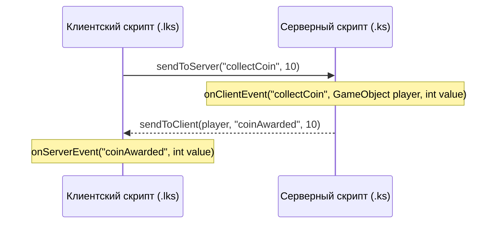

# Level Script — полная документация

Level Script — интерпретируемый C-подобный язык для анимации и логики уровня. Скрипты хранятся в папке мира `Scripts/` (точка входа `main.ks`), пишутся в режиме **Code** у Kaplao и выполняются на **сервере** (listen host). Клиенты видят результат через синхронизацию тайлов. Старые миры с `LevelData.script` в `level.json` мигрируют при загрузке.

Запуск: кнопки **Run** / **Stop** в Code mode. Пока скрипт запущен, группы тайлов могут двигаться, вращаться, менять видимость, создавать объекты, настраивать физику, управлять камерой, задним планом, звуками и выводить интерфейс.

---

## Содержание

1. [Как устроен рантайм](#как-устроен-рантайм)
2. [Быстрый старт](#быстрый-старт)
3. [Структура программы](#структура-программы)
4. [Типы и значения](#типы-и-значения)
5. [Переменные и области видимости](#переменные-и-области-видимости)
6. [Выражения](#выражения)
7. [Управление потоком](#управление-потоком)
8. [Функции](#функции)
9. [Параллельность (`spawn`)](#параллельность-spawn)
10. [Группы и объекты](#группы-и-объекты)
11. [Триггеры](#триггеры)
12. [Игроки](#игроки)
13. [Встроенные команды анимации](#встроенные-команды-анимации)
14. [Управление хитбоксами и коллизиями](#управление-хитбоксами-и-коллизиями)
15. [Спрайты, цвет и визуальные эффекты](#спрайты-цвет-и-визуальные-эффекты)
16. [Управление камерой (`Camera`)](#управление-камерой-camera)
17. [Управление задним планом (`Background`)](#управление-задним-планом-background)
18. [Мир, физика и сетка тайлов (`World`)](#мир-физика-и-сетка-тайлов-world)
19. [Интерфейс уровня (`UI`)](#интерфейс-уровня-ui)
20. [Звук](#звук)
21. [Спавн и чекпоинты](#спавн-и-чекпоинты)
22. [Создание объектов и компоненты](#создание-объектов-и-компоненты)
23. [Easing](#easing)
24. [Возможности встроенной IDE](#возможности-встроенной-ide)
25. [Комментарии и точки с запятой](#комментарии-и-точки-с-запятой)
26. [Локальные скрипты (.lks) и сетевые события](#локальные-скрипты-lks-и-сетевые-события)
27. [Примеры](#примеры)
28. [Ошибки и ограничения](#ошибки-и-ограничения)

---

## Как устроен рантайм

| Часть | Файл / роль |
|-------|-------------|
| Парсер | `LevelScriptParser` — текст → AST |
| Узлы AST | `LevelScriptNodes` — синтаксическое дерево |
| Модули | `LevelScriptModuleLinker` — `using` / `public` / `private` |
| Исполнение | `LevelScriptRuntime` — корутины Unity, слежение за камерой, очистка при Stop |
| Утилиты объектов | `LevelScriptObjectUtility` — поиск объектов сцены, тайлов, настройка коллайдеров и спрайтов |
| Анимация групп | `LevelGroupAnimator` — pivot’ы, move/rotate/scale |
| Задний план | `ParallaxBackground` — многослойный параллакс, скорости, смещения и цвета |
| Keyframes | `KeyframeAnimator` — `animate` и Executor с Use Keyframes |
| Executor | `ExecutorRuntime` — визуальные анимации без кода |
| Триггеры | `LevelScriptTriggerBridge` — overlap в `FixedUpdate` |
| IDE Сервис | `LevelScriptIdeService` — подсветка, контекстный автокомплит, сигнатуры |
| Редактор кода | `LevelScriptCodeEditorEnhancer` — навигация стрелками, Tab-сниппеты, автозакрытие скобок |
| Локальный рантайм | `LevelScriptLocalRuntime` — исполнение клиентских `.lks` скриптов и прием сетевых событий |

Важные правила:

- Скрипт выполняется **только на сервере**.
- `move` / `goto` / `rotate` / `rotateto` / `scaleto` / `transparency` **не блокируют** поток: анимация идёт в фоне. Чтобы «дождаться» конца, используйте `wait(duration)`.
- `onTriggerStay` не запускает новую корутину, пока предыдущая для той же пары (handler + актор) ещё работает.
- После **Stop** всё возвращается в исходное состояние:
  - **Тайлы**: позиция, поворот, масштаб, hitbox, прозрачность, цвет, текстура.
  - **Гравитация и время**: восстанавливаются исходные значения `Physics2D.gravity` и `Time.timeScale = 1`.
  - **Камера**: отвязывается от цели, останавливается тряска/зум/fade, оверлеи удаляются.
  - **Задний план**: восстанавливается к начальному состоянию.
  - **Добавленные компоненты**: удаляются (например, Rigidbody2D).
  - **Созданные объекты**: уничтожаются (через `instance()`).
  - **Уничтоженные объекты**: восстанавливаются (если существовали до Run).

---

## Быстрый старт

Платформа поднимается, когда раннер входит в триггер группы `1`:

```csharp
Group(1).OnTriggerEnter(GameObject player) {
  move(Group(2), 0, 5, 1, "easeInOut")
  wait(1)
  move(Group(2), 0, -5, 1, "easeInOut")
}
```

Кинематографичная сцена со встряской, замедлением времени и баннером:

```csharp
spawn {
  UI.showBanner("БОСС ПОЯВИЛСЯ!", 3, "#FF3333")
  Camera.shake(0.8, 1.5)
  World.setTimeScale(0.3)
  wait(0.5)
  World.setTimeScale(1.0)
  Camera.zoom(14, 1.0, "easeOut")
}
```

---

## Структура программы

Скрипт — последовательность элементов верхнего уровня:

| Элемент | Синтаксис | Назначение |
|---------|-----------|------------|
| Импорт | `using path/file.ks` | Подключить public-символы файла |
| Функция | `[public\|private] function name(params) { ... }` | Переиспользуемый код |
| Переменная | `[public\|private] int x = 0;` | Глобаль (по умолчанию private) |
| Триггер (объектный) | `Group(g).OnTriggerEnter(GameObject player) { ... }` | Вход раннера в триггер |
| | `Group(g).OnTriggerStay(GameObject player) { ... }` | Нахождение в триггере |
| | `Group(g).OnTriggerExit(GameObject player) { ... }` | Выход из триггера |
| Триггер (классика) | `onTriggerEnter(g) { ... }` | Вход раннера в группу `g` |
| Игрок | `onPlayerAdded(player) { ... }` | Новый раннер после старта скрипта |
| Чекпоинты | `spawnPoints(from, to)` | Авто-чекпоинты для групп |
| Параллель | `spawn { ... }` | Отдельная фоновая корутина |
| Тело | любые операторы | Главный поток исполнения |

---

## Типы и значения

| Тип | Литералы | Примечание |
|-----|----------|-----------|
| `int` | `0`, `42`, `-3` | Целая арифметика; `/` — целочисленное деление |
| `float` | `1.5`, `0.25`, `-9.8` | Дробные числа с плавающей точкой |
| `bool` | `true`, `false` | Логический тип |
| `string` | `"hello"`, `"linear"` | Текстовые строки в двойных кавычках |
| `GameObject` | `Group(1)`, `player`, `Scene.ObjectName`, `nil` | Ссылка на тайлы, группу, игрока или объект сцены |
| `Component` | `obj.GetComponent<Type>()`, `nil` | Ссылка на Unity-компонент |
| `list` (`int[]`) | `[1, 2, 3]`, `["a", "b"]`, `[]` | Динамический список элементов с методами `.add()`, `.removeAt()`, `.clear()` |

### Списки и динамические массивы (`list` / `T[]`)

LevelScript поддерживает динамические списки элементов:

```csharp
// Создание списка через ключевое слово list или тип[]
list targets = [101, 102, 103]
int[] speeds = [2, 4, 8]

// Добавление элементов в конец
targets.add(104)

// Чтение и изменение по индексу (0-based)
int firstTarget = targets[0]
targets[0] = 200

// Удаление элемента по индексу
targets.removeAt(1)

// Количество элементов (.count или .length)
for (int i = 0; i < targets.count; i++) {
  move(Group(targets[i]), 0, 3, 0.5, "easeInOut")
}

// Полная очистка списка
targets.clear()
```

### `nil`

Специальное значение «нет объекта». Поддерживает сравнения `==` и `!=`:

```csharp
GameObject nearest = FindNearestPlayer(0.0, 0.0);
if (nearest != nil) {
  move(nearest, 0, 1, 0.5, "easeOut")
}
```

---

## Переменные и области видимости

### Объявление

```csharp
int counter = 0;
float delay = 0.5;
bool active = true;
string mode = "easeInOut";
GameObject target = nil;
Component rb = nil;
```

Объявление переменной требует `;` в конце.

### Присваивание и составные операторы

```csharp
counter = counter + 1;
counter += 5;
counter -= 2;
delay *= 1.5;
counter %= 4;
mode += " (fast)"; // конкатенация строк
```

### Инкремент / декремент

```csharp
counter++;
counter--;
```

В циклах `for` поддерживается как полный инкремент, так и сокращённая запись (`for (int i = 0; i < 10; i++)` или `for (int i = 0; i < 10; i)`).

---

## Выражения

### Арифметика

`+`, `-`, `*`, `/`, `%` с соблюдением стандартного приоритета операций и группировкой через круглые скобки `( )`.

### Математические функции

| Функция | Описание |
|---------|----------|
| `abs(x)` | Абсолютное значение (модуль) |
| `min(a, b)` | Минимальное из двух чисел |
| `max(a, b)` | Максимальное из двух чисел |
| `sin(rad)` | Синус (угол в радианах) |
| `cos(rad)` | Косинус (угол в радианах) |
| `sqrt(x)` | Квадратный корень |
| `floor(x)` | Округление вниз |
| `ceil(x)` | Округление вверх |
| `clamp(val, min, max)` | Ограничение диапазона |
| `random(min, max)` | Случайное дробное число от `min` до `max` |

### Логика

`!`, `&&`, `||`, сравнения `<`, `<=`, `>`, `>=`, `==`, `!=`.

---

## Управление потоком

### Циклы

```csharp
while (active) {
  move(Group(1), 0, 3, 0.5, "easeInOut")
  wait(0.5)
  move(Group(1), 0, -3, 0.5, "easeInOut")
  wait(0.5)
}

for (int i = 0; i < 5; i++) {
  move(Group(100 + i), 0, 2, 0.2, "easeOut")
  wait(0.05)
}
```

Поддерживаются `break;` и `continue;` внутри любых циклов.

В циклах работает **Anti-Freeze Watchdog**: если цикл выполнил 5000 итераций без `wait`, управление отдаётся следующему кадру Unity, предотвращая зависание игры. Превышение 200 000 итераций останавливает цикл с выводом ошибки.

### Ветвления

```csharp
if (counter == 0) {
  move(Group(1), 5, 0, 1, "easeOut")
} else if (counter == 1) {
  move(Group(1), -5, 0, 1, "easeIn")
} else {
  Camera.shake(0.5, 0.5)
}
```

---

## Функции

```csharp
function createWave(int baseGroup, int count, float delay) {
  for (int i = 0; i < count; i++) {
    move(Group(baseGroup + i), 0, 2, 0.3, "easeInOut")
    wait(delay)
  }
}
```

Функции могут возвращать значения через `return value;`. Модификаторы `public` и `private` позволяют экспортировать функции для директивы `using`.

---

## Параллельность (`spawn`)

Каждый блок `spawn { ... }` запускает независимую корутину:

```csharp
spawn {
  while (true) {
    move(Group(1), 2, 0, 1, "easeInOut")
    wait(1)
    move(Group(1), -2, 0, 1, "easeInOut")
    wait(1)
  }
}

spawn {
  while (true) {
    rotate(Group(2), Group(2), 360, 4, "linear")
    wait(4)
  }
}
```

Внутри `spawn` поддерживается вложенный `spawn`, а также доступ к локальным переменным охватывающего цикла `for` без конфликтов областей видимости.

---

## Группы и объекты

- `Group(id)` — возвращает массив тайлов, входящих в группу `id`.
- `{obj1, obj2, obj3}` — литерал массива произвольных объектов.
- `Scene.Path.To.Object` — получение объекта сцены Unity по имени в иерархии (например `Scene.ParallaxBackground`).

---

## Триггеры

Объектный синтаксис (рекомендуется):

```csharp
Group(1).OnTriggerEnter(GameObject player) {
  UI.showBanner("Ловушка активирована!", 2, "#FF4444")
  move(Group(2), 0, -4, 0.3, "easeIn")
}

Group(1).OnTriggerStay(GameObject player) {
  // Вызывается каждый кадр, пока игрок внутри
}

Group(1).OnTriggerExit(GameObject player) {
  // Вызывается при выходе игрока из зоны
}
```

---

## Игроки

Серверный скрипт может реагировать на подключение игроков в сессию и считывать их текущие параметры:

### Событие подключения игрока
```csharp
onPlayerAdded(GameObject player) {
  UI.showBanner("Игрок " + player.name + " вошел в игру!", 3, "#55FF55")
  playSound(player.x, player.y, "custom/welcome.mp3", 1.0)
}
```

### Свойства объекта игрока (`GameObject`)
- `player.x` — текущая координата X игрока в мире.
- `player.y` — текущая координата Y игрока в мире.
- `player.name` — никнейм игрока.

---

## Встроенные команды анимации

| Команда | Описание |
|---------|----------|
| `move(targets, dx, dy, time, ease)` | Сдвиг объектов на `(dx, dy)` относительно текущей позиции |
| `goto(targets, x, y, time, ease)` | Перемещение объектов в абсолютные координаты `(x, y)` |
| `rotate(targets, pivot, deg, time, ease)` | Поворот вокруг pivot на угол `deg` |
| `rotateto(targets, pivot, targetX, targetY, offset, time, ease)` | Наведение на точку `(targetX, targetY)` |
| `scaleto(targets, sx, sy, time, ease)` | Масштабирование объектов |
| `animate(targetGroup, keyframesGroup)` | Запуск анимации по ключевым кадрам |
| `spawnExecutor(targets)` | Запуск встроенного Executor |
| `wait(seconds)` | Приостановка выполнения текущей корутины на `seconds` секунд |

---

## Управление хитбоксами и коллизиями

Позволяет тонко настраивать форму, проходимость и физические свойства коллизий тайлов и объектов:

| Команда | Параметры | Описание |
|---------|-----------|----------|
| `hitbox(targets, enabled)` | `(targets, bool)` | Включить или выключить коллайдер |
| `setHitboxSize(targets, w, h)` | `(targets, float, float)` | Установить ширину и высоту коллайдера |
| `setHitboxOffset(targets, ox, oy)` | `(targets, float, float)` | Установить смещение центра коллайдера |
| `setHitboxTrigger(targets, isTrigger)` | `(targets, bool)` | Переключить в режим триггера (сквозной сенсор) |
| `setHitboxBounce(targets, bounce)` | `(targets, float)` | Установить коэффициент упругости (отскок) |
| `setHitboxFriction(targets, friction)`| `(targets, float)` | Установить силу трения поверхности |

*Псевдонимы: `hitboxSize`, `hitboxOffset`, `hitboxTrigger`, `hitboxBounce`, `hitboxFriction`.*

Пример:

```csharp
// Создать батут с высоким отскоком
setHitboxBounce(Group(5), 1.5)

// Сделать ловушку сквозным триггером с увеличенной зоной срабатывания
setHitboxTrigger(Group(6), true)
setHitboxSize(Group(6), 3.0, 2.0)
```

---

## Спрайты, цвет и визуальные эффекты

| Команда | Параметры | Описание |
|---------|-----------|----------|
| `destroySprite(targets)` | `(targets)` | Удаляет/выключает визуальный спрайт `SpriteRenderer`. Объект, коллайдер и логика остаются в мире! |
| `setSpriteFlip(targets, flipX, flipY)` | `(targets, bool, bool)` | Отразить спрайт по X и/или Y |
| `setSortingOrder(targets, order)` | `(targets, int)` | Установить слой сортировки (порядок отрисовки) |
| `setSpriteAlpha(targets, alpha)` | `(targets, float)` | Мгновенно задать альфа-прозрачность (0.0 — 1.0) |
| `setSpriteColor(targets, hex)` | `(targets, string)` | Задать цвет спрайта (`"#FF5500"` или `"FF5500"`) |
| `setColor(targets, hex)` | `(targets, string)` | Синоним для смены цвета тайла |
| `setTexture(targets, textureId)` | `(targets, string)` | Сменить текстуру тайла по идентификатору |
| `transparency(targets, val, time, ease)` | `(targets, float, float, string)` | Плавное изменение прозрачности |
| `visibility(targets, visible)` | `(targets, bool)` | Включить или выключить видимость |

Пример:

```csharp
// Невидимая платформа: спрайт удалён, но коллайдер остаётся твердым
destroySprite(Group(10))

// Мигающая полупрозрачная стена
setSpriteAlpha(Group(11), 0.3)
setSpriteFlip(Group(11), true, false)
setSortingOrder(Group(11), 10)
```

---

## Управление камерой (`Camera`)

Поддерживается как точечный синтаксис `Camera.method()`, так и глобальные функции `cameraMethod()`:

| Команда | Параметры | Описание |
|---------|-----------|----------|
| `Camera.shake(intensity, duration)` | `(float, float)` | Тряска камеры с силой `intensity` на `duration` секунд |
| `Camera.zoom(size, duration, ease)` | `(float, float = 0, string = "linear")` | Изменение размера камеры `orthographicSize` (меньше = ближе) |
| `Camera.panTo(x, y, duration, ease)` | `(float, float, float = 0, string = "linear")` | Перемещение камеры в точку `(x, y)` |
| `Camera.follow(target)` | `(GameObject)` | Привязать слежение камеры к объекту или игроку |
| `Camera.unfollow()` | `()` | Отвязать камеру от объекта |
| `Camera.fade(alpha, duration, color)`| `(float, float = 1, string = "#000000")` | Плавное затемнение или заливка экрана цветом |

*Глобальные синонимы: `cameraShake`, `cameraZoom`, `cameraPanTo`, `cameraFollow`, `cameraUnfollow`, `cameraFade`.*

Пример:

```csharp
Group(1).OnTriggerEnter(GameObject player) {
  // Кинематографичный фокус на секретной двери
  Camera.panTo(25, 10, 1.5, "easeInOut")
  Camera.zoom(5, 1.5, "easeInOut")
  wait(2.0)
  
  // Возврат камеры к игроку
  Camera.follow(player)
  Camera.zoom(8, 1.0, "easeOut")
}
```

---

## Управление задним планом (`Background`)

Управляет многослойным параллаксом уровня (`ParallaxBackground`):

| Команда | Параметры | Описание |
|---------|-----------|----------|
| `Background.clear()` | `()` | Очистить все слои заднего плана |
| `Background.reset()` | `()` | Сбросить задний план к начальному виду уровня |
| `Background.hide(layerIndex)` | `(int)` | Скрыть конкретный слой параллакса (индекс от 0) |
| `Background.show(layerIndex)` | `(int)` | Показать скрытый слой |
| `Background.setColor(layer, hex)` | `(int, string)` | Перекрасить слой в указанный hex-цвет |
| `Background.setSpeed(layer, speed)` | `(int, float)` | Установить скорость следования за камерой (0.0…1.0) |
| `Background.setOffset(layer, yOffset)` | `(int, float)` | Установить смещение слоя по высоте |
| `Background.setAlpha(layer, alpha)` | `(int, float)` | Установить прозрачность слоя |

*Глобальные синонимы: `backgroundClear`, `backgroundReset`, `backgroundHide`, `backgroundShow`, `backgroundColor`, `backgroundSpeed`, `backgroundOffset`, `backgroundAlpha`.*

Пример:

```csharp
// Ночная фаза: затемнить дальние горы и облака, ускорить их движение
Background.setColor(0, "#222244")
Background.setColor(1, "#333366")
Background.setSpeed(1, 0.4)
Background.setAlpha(2, 0.5)
```

---

## Мир, физика и сетка тайлов (`World`)

Позволяет изменять глобальные правила физики и динамически менять тайлы в рантайме:

| Команда | Параметры | Описание |
|---------|-----------|----------|
| `World.setGravity(gx, gy)` | `(float, float)` | Задать гравитацию мира 2D (`setGravity`) |
| `World.setTimeScale(scale)` | `(float)` | Задать скорость течения времени (`setTimeScale`, slow-mo) |
| `World.setTile(x, y, tileId)` | `(int, int, int)` | Установить тайл в ячейку сетки (`setTile`) |
| `World.removeTile(x, y)` | `(int, int)` | Удалить тайл из ячейки сетки (`removeTile`) |
| `World.hasTile(x, y)` | `(int, int) -> bool` | Проверить наличие тайла в ячейке сетки (`hasTile`) |

Идентификаторы тайлов (`tileId`): `1` — Block, `2` — Spike, `3` — Trigger, `4` — Particle, `5` — Keyframe, `6` — Executor.

Пример:

```csharp
// Секция невесомости
Group(1).OnTriggerEnter(GameObject player) {
  World.setGravity(0, 0)
  UI.showBanner("НЕВЕСОМОСТЬ АКТИВИРОВАНА", 2, "#66CCFF")
}

// Разрушающийся мост
Group(2).OnTriggerEnter(GameObject player) {
  for (int x = 10; x <= 15; x++) {
    if (World.hasTile(x, 4)) {
      World.removeTile(x, 4)
      playSound(x, 4, "block/stone/break", 1.5)
      wait(0.2)
    }
  }
}
```

---

## Интерфейс уровня (`UI`)

Позволяет отображать визуальные подсказки, баннеры и таймеры поверх игрового экрана:

| Команда | Параметры | Описание |
|---------|-----------|----------|
| `UI.showBanner(text, duration, color)` | `(string, float = 3, string = "#FFFFFF")` | Вывести всплывающий экранный баннер |
| `UI.showTimer(seconds, label)` | `(float, string = "")` | Запустить обратный отсчет на экране |

*Глобальные синонимы: `showBanner`, `showTimer`.*

Пример:

```csharp
spawn {
  UI.showBanner("ПРИГОТОВЬТЕСЬ К ЗАБЕГУ!", 3, "#FFD700")
  wait(3.0)
  UI.showTimer(20.0, "ВРЕМЯ ДО ЗАКРЫТИЯ ДВЕРИ")
  wait(20.0)
  UI.showBanner("ДВЕРЬ ЗАКРЫТА!", 2, "#FF3333")
  World.setTile(20, 5, 1)
}
```

---

## Консоль Output и вывод (`print()`)

В LevelScript IDE встроен полноценный многострочный терминал вывода **OUTPUT**:
- **Временные метки**: каждое сообщение имеет точное время `[HH:mm:ss]`.
- **Цветовая индикация**:
  - **Красный**: ошибки компиляции, синтаксиса и рантайма (`[Error]`).
  - **Желтый**: системные предупреждения (`[Warning]`).
  - **Белый**: результаты вызовов `print(...)` и информационные логи.
- **Копирование**: кнопка **Copy** копирует весь чистый лог в буфер обмена (без HTML-тегов). Также текст можно выделять мышью и копировать с помощью `Ctrl+C`.
- **Очистка**: кнопка **Clear** очищает вывод.
- **Сворачивание**: кнопка **▼ / ▲** позволяет свернуть панель, чтобы увеличить рабочую область редактора кода (при возникновении новой ошибки консоль разворачивается автоматически).

### `print(value, ...)`
Выводит любые значения в консоль Output:
```csharp
print("Script started!")
print("Player position:", player.x, player.y)

list inventory = ["key", "potion", "sword"]
print("Inventory:", inventory)
print("Items count:", inventory.count, "First item:", inventory[0])

int score = 100
print("Current score is: " + score)
```

---

## Звук

### `playSound(x, y, path, volume)`

Воспроизводит 2D/3D звук в координатах мира:

```csharp
playSound(0, 0, "custom/shot.mp3", 1.5)
playSound(player.x, player.y, "item/shield/block1.ogg", 2.0)
```

---

## Спавн и чекпоинты

- `spawnPoint(player, x, y)` — задать точку возрождения для игрока.
- `spawnPoints(from, to)` — зарегистрировать группы от `from` до `to` как автоматические чекпоинты.

---

## Создание объектов и компоненты

### `instance("type", x, y) -> GameObject`

Создает новый динамический объект в мире (`"Block"`, `"Spike"`, `"Runner"` и т.д.):

```csharp
GameObject spike = instance("Spike", 10.0, 5.0)
```

### `destroy(targets)`

Уничтожает указанные объекты или группы тайлов. При нажатии **Stop** уничтоженные исходные объекты восстанавливаются.

### Компоненты Unity

```csharp
GameObject platform = Scene.MovingPlatform;
platform.AddComponent<Rigidbody2D>();

Component rb = platform.GetComponent<Rigidbody2D>();
rb.Mass = 5.0;
rb.AddForce(0.0, 20.0);
```

---

## Easing

Строка функции интерполяции (регистр не имеет значения):

| Значение | Описание |
|----------|----------|
| `"linear"` | Равномерное движение |
| `"easeIn"` | Медленный старт с ускорением |
| `"easeOut"` | Быстрый старт с плавным замедлением |
| `"easeInOut"` | Плавный разгон и плавное торможение |

---

## Возможности встроенной IDE

Встроенный редактор в режиме **Code** оснащен продвинутой системой автодополнения и подсказок:

1. **Контекстный автокомплит после точки (`.`):**
   - При вводе `Background.` открывается список методов управления параллаксом (`clear`, `hide`, `show`, `setColor`, `setSpeed`, `setOffset`, `setAlpha`, `reset`).
   - При вводе `Camera.` предлагаются команды управления камерой (`shake`, `zoom`, `panTo`, `follow`, `unfollow`, `fade`).
   - При вводе `World.` предлагаются методы физики и сетки (`setGravity`, `setTimeScale`, `setTile`, `removeTile`, `hasTile`).
   - При вводе `UI.` предлагаются методы интерфейса (`showBanner`, `showTimer`).
   - При вводе `Group(...).` или `player.` предлагаются поля координат (`x`, `y`, `scaleX`, `scaleY`, `alpha`, `color`, `visible`) и события триггеров.

2. **Подсказка строковых литералов:**
   - Внутри кавычек `"` автоматически подсказываются функции easing (`"linear"`, `"easeIn"`, `"easeOut"`, `"easeInOut"`), имена компонентов (`"Particle"`, `"Rigidbody2D"`, `"Hitbox"`) и цвета.

3. **Навигация по кандидатам стрелками $\uparrow$ / $\downarrow$:**
   - Если под префикс подходит несколько ключевых слов, нажатие клавиш **Стрелка Вверх** и **Стрелка Вниз** переключает выбранный вариант прямо в ghost-подсказке на лету.

4. **Быстрое принятие по `Tab` или `Enter`:**
   - Нажатие `Tab` или `Enter` мгновенно применяет текущую подсказку.

5. **Умные сниппеты по клавише `Tab`:**
   - `for` + `Tab` $\to$ разворачивает полный шаблон цикла `for (int i = 0; i < 10; i++)` с автоматическим отступом и установкой каретки внутри тела.
   - `while` + `Tab` $\to$ разворачивает цикл `while (true)`.
   - `spawn` + `Tab` $\to$ разворачивает параллельный блок `spawn { ... }`.
   - `trigger` + `Tab` $\to$ разворачивает шаблон `Group(1).OnTriggerEnter(GameObject player) { ... }`.

6. **Активная подсветка параметров в сигнатурах:**
   - В строке состояния редактора при наборе аргументов вызова функции аргумент, который вы сейчас редактируете, **подсвечивается жирным синим цветом** `<b><color=#569CD6>param</color></b>`. При вводе запятой подсветка мгновенно переходит на следующий параметр!

---

## Комментарии и точки с запятой

```csharp
// Однострочный комментарий

/* Многострочный блочный комментарий,
   может занимать сколько угодно строк */
```

В IDE оба вида комментариев подсвечиваются зеленым цветом `#6A9955`.

---

## Локальные скрипты (.lks) и сетевые события

Level Script разделяет выполнение на **серверную** (`.ks`) и **клиентскую** (`.lks` / `.kls`) логику:

| Тип скрипта | Расширение | Где исполняется | Назначение |
|---|---|---|---|
| Серверный | `.ks` (например `main.ks`) | **Сервер** (listen host) | Синхронизированное движение групп тайлов, физика, спавн, триггеры уровня. |
| Локальный | `.lks` (например `client.lks`) | **Клиент** (у каждого игрока локально) | Локальные эффекты камеры, локальный UI, персональные звуки, логика управления. |

### Создание локального скрипта в IDE
В файловом проводнике встроенной IDE нажмите правой кнопкой мыши по папке `Scripts/` $\to$ **New Local Script (.lks)**. По умолчанию создаётся файл `client.lks`.

### Локальный игрок (`localPlayer`)
В локальных скриптах доступно ключевое слово `localPlayer`, возвращающее `GameObject` управляемого данным клиентом персонажа:
```csharp
// client.lks
spawn {
  while (true) {
    if (localPlayer.y < -15.0) {
      Camera.shake(0.3, 0.5)
    }
    wait(0.2)
  }
}
```
Доступные поля `localPlayer`:
- `localPlayer.x` — координата X локального игрока.
- `localPlayer.y` — координата Y локального игрока.
- `localPlayer.name` — никнейм локального игрока.

### Сетевое взаимодействие между `.lks` и `.ks`

Скрипты могут безопасно вызывать именованные события на другой стороне и передавать типизированные аргументы (`int`, `float`, `bool`, `string`):



#### 1. Клиент $\to$ Сервер
- **Отправка с клиента (`.lks`)**:
  ```csharp
  sendToServer("requestDoorOpen", 42)
  // или с явным префиксом модуля Network:
  Network.sendToServer("requestDoorOpen", 42)
  ```
- **Приём на сервере (`.ks`)**:
  Первым аргументом обработчика всегда автоматически передаётся ссылка на `GameObject player`, отправивший запрос:
  ```csharp
  onClientEvent("requestDoorOpen", GameObject player, int doorId) {
    UI.showBanner("Игрок " + player.name + " открыл дверь " + doorId, 2, "#FFD700")
    move(Group(doorId), 0, 4, 1.0, "easeInOut")
  }
  ```

#### 2. Сервер $\to$ Конкретный клиент
- **Отправка с сервера (`.ks`)**:
  Первым параметром указывается объект игрока-получателя:
  ```csharp
  sendToClient(player, "secretNotice", "Вы обнаружили тайник!")
  // или:
  Network.sendToClient(player, "secretNotice", "Вы обнаружили тайник!")
  ```
- **Приём на клиенте (`.lks`)**:
  ```csharp
  onServerEvent("secretNotice", string msg) {
    UI.showBanner(msg, 3, "#00FFAA")
    Camera.shake(0.2, 0.4)
  }
  ```

#### 3. Сервер $\to$ Всем клиентам одновременно
- **Отправка с сервера (`.ks`)**:
  ```csharp
  sendToAllClients("bossRage", 1.5)
  // или:
  Network.sendToAllClients("bossRage", 1.5)
  ```
- **Приём на клиентах (`.lks`)**:
  ```csharp
  onServerEvent("bossRage", float intensity) {
    Camera.shake(intensity, 2.0)
    playSound(0, 0, "custom/alarm.mp3", 1.5)
  }
  ```

### Изоляция локального контекста
Все визуальные и звуковые операции в `.lks` (`Camera.shake`, `Camera.zoom`, `Camera.fade`, `UI.showBanner`, `UI.showTimer`, перемещение объектов или проигрывание звуков) изолированы на клиенте и не вызывают сетевой рассинхронизации у других игроков.

---

## Примеры

### 1. Битва с боссом: тряска, смена фона и таймер выживания

```csharp
spawn {
  UI.showBanner("ВНИМАНИЕ: АКТИВАЦИЯ СИСТЕМЫ ЗАЩИТЫ!", 3, "#FF2222")
  Background.setColor(0, "#551111")
  Camera.shake(0.6, 2.0)
  wait(2.0)
  
  UI.showTimer(15.0, "ПЕРЕЖИВИТЕ АТАКУ")
  World.setGravity(0, -5.0)
  
  for (int i = 0; i < 5; i++) {
    Camera.shake(0.4, 0.5)
    playSound(0, 0, "custom/shot.mp3", 1.5)
    move(Group(10), 0, -3, 0.2, "easeIn")
    wait(1.5)
    move(Group(10), 0, 3, 0.5, "easeInOut")
    wait(1.5)
  }
  
  World.setGravity(0, -9.8)
  Background.reset()
  UI.showBanner("АТАКА ОТБИТА!", 3, "#00FF66")
}
```

### 2. Секретная комната: невидимый барьер и проверка тайлов

```csharp
// Скрываем спрайты тайлов секретного прохода
destroySprite(Group(25))

Group(20).OnTriggerEnter(GameObject player) {
  if (World.hasTile(15, 8)) {
    // Убираем стену и открываем проход
    World.removeTile(15, 8)
    playSound(15, 8, "block/stone/break", 2.0)
    UI.showBanner("СЕКРЕТНЫЙ ПРОХОД ОТКРЫТ!", 2, "#FFD700")
    Camera.zoom(6.0, 1.0, "easeInOut")
    wait(2.0)
    Camera.zoom(8.0, 1.0, "easeInOut")
  }
}
```

---

## Ошибки и ограничения

- Ошибка компиляции или выполнения мгновенно отображается красным подчеркиванием в IDE и текстом с номерами строки и колонки в строке статуса.
- Все созданные объекты, тайлы, параметры гравитации, камеры и фона гарантированно возвращаются в исходный вид при нажатии кнопки **Stop**.
- Скрипты сохраняются в файлах `{World}/Scripts/main.ks`.
